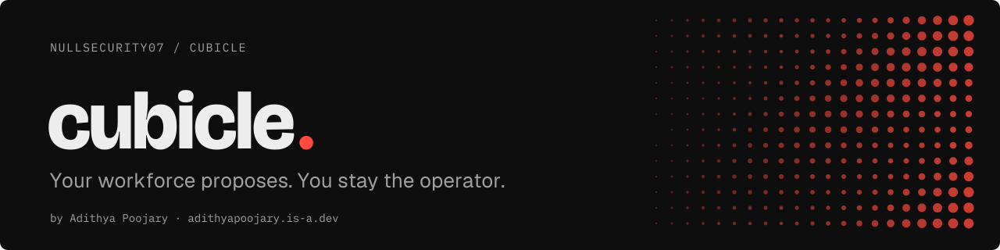
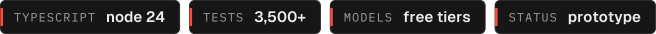
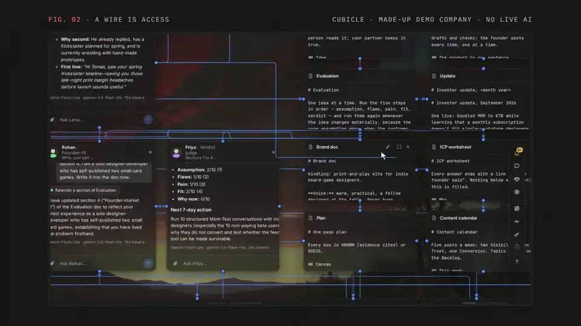
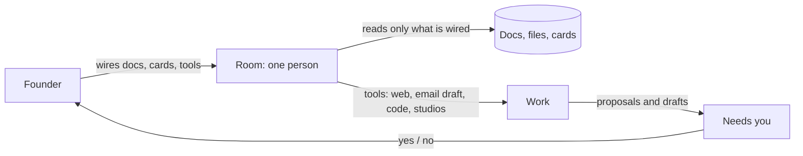

<p align="center"><a href="https://adithyapoojary.is-a.dev/work/cubicle/"><picture><source media="(prefers-color-scheme: light)" srcset=".github/readme/banner-light.svg"></picture></a></p>
<p align="center"><picture><source media="(prefers-color-scheme: light)" srcset=".github/readme/badges-light.svg"></picture></p>

Cubicle is a canvas where a solo founder works with a small workforce of people, each in their own room, and stays the operator: people speed the founder up and propose, the founder decides.

<p align="center"><a href="https://adithyapoojary.is-a.dev/work/cubicle/"></a><br><sub>A clip from the walkthrough. <a href="https://adithyapoojary.is-a.dev/work/cubicle/">Watch the full video</a>.</sub></p>

Every person sits in a room on a stage you can see, reads only what you wired to them, and asks before anything leaves the machine. The work is visible, the access is drawn by hand, and the last word is always the founder's. Nothing runs while the app is closed unless you install the background service yourself.

## Highlights

- **Wires are access.** Rooms, documents, files, cards and tools are cards on one canvas. Draw a wire from a document to a person and they can read it; no wire, no access. Pinned documents are read by everyone.
- **People propose, you decide.** A person can draft an email, suggest a runway scenario or propose a decision, but sending, accepting and deciding stay with you. Every yes the app is waiting for sits in one **Needs you** list, and a standing yes can be taken back.
- **Seventeen ready teams on four shelves**: Find out, Build and sell, Run the company, Raise. Customer discovery, positioning, pre-mortem, pricing, seed round prep, pitch practice and more, each placed on the stage in one press and scored by its own evals.
- **Cards a founder actually uses**: a light CRM for leads (CSV import, nudges for leads gone quiet), a competitor watcher with a change timeline, metrics with a north star, a runway card with up to three scenarios over 24 months, consented customer interviews transcribed on the machine, a Sean Ellis survey, a deck maker that exports PDF and PowerPoint, and a one-page site studio.
- **Studios that run locally where they can**: Image, Voice and Video studios draw, speak and cut a short film from a brief. Voices run on the machine (Kokoro), interview transcripts stay on the machine (whisper.cpp), and Recall searches everything by meaning with a local embedding model.

## How it works



1. Place rooms on the stage, or press a ready team onto it from the frameworks shelf.
2. Wire each person to the documents, files and cards they should see. A person changes one section of a shared document at a time (`replace_section`), and a rewrite that would drop most of a document is refused.
3. Talk to a person in their room. They work with tools (web search and reading, a browser card, sandboxed code, consults with colleagues, handing whole pieces of work to another person) and answer from what their wires let them read.
4. Anything that leaves the machine or changes your numbers comes back as a proposal: an email to send, a lead to mark contacted, a decision to make. Decisions are kept as one markdown file each.
5. Task boards run work in the background on schedules typed in words, one task starting the next. Each person keeps a few notes of their own, and the company playbook turns what was learned into skills read before the work they fit.

## Quick start

Requires Node.js (developed on Node 24) and pnpm. The desktop window is optional and needs Rust.

```bash
git clone https://github.com/NullSecurity07/cubicle.git
cd cubicle
./start.sh                 # installs dependencies on first run, then open http://localhost:7420
```

Or by hand:

```bash
cd app
pnpm install
pnpm dev                   # http://localhost:7420
```

Model keys go in `.env` at the repository root (or paste them in the app's Keys panel). One free key is enough to start, and every provider the app knows has a free tier:

```bash
GROQ_API_KEY=...
GEMINI_API_KEY=...
# also read: CEREBRAS_API_KEY, NVIDIA_API_KEY, OLLAMA_API_KEY, OPENROUTER_API_KEY and more (see app/server/models.json)
```

To look around without your own data, open **Kindling**, a made-up showcase company, on a fresh copy:

```bash
./start.sh --showcase      # http://localhost:7440
```

Useful scripts in `app/`:

| Command | What it does |
| --- | --- |
| `pnpm gate` | typecheck, unit tests and browser journeys |
| `pnpm health` | every dependency checked, in plain words |
| `pnpm check:providers` | asks each model provider once, prints OK, NO KEY or the error |
| `pnpm shell:build` then `pnpm shell` | builds and opens the desktop window (Tauri) |
| `pnpm service:install` | optional user service that keeps it running while the window is closed |

Your data lives in `workspace/`, which is not in git. The API listens on 127.0.0.1 only and answers only the app's own page.

## Project layout

```
app/
  src/          the stage: canvas, rooms, cards (React, React Flow, Vite)
  server/       rooms, tools, studios, safety checks, slices per card
  shared/       code used by both sides (runway, metrics, competitor)
  frameworks/   the seventeen ready teams and their notes
  skills/       the sixteen built-in skills
  showcase/     Kindling, the made-up company
  shell/        the desktop window (Tauri)
  e2e/          browser journeys (Playwright)
site/           the product page
start.sh        starts the API and the page together
```

## Status

Active prototype, built solo: 1,830 commits on main between 2 September and 9 October 2026, with about 3,500 unit and browser tests (`pnpm gate`). Known gaps: no installer yet, and the desktop window on Linux may not play films or recordings without GStreamer's "good" plugins (the browser plays them).

## Built by

Built by [Adithya Poojary](https://adithyapoojary.is-a.dev), founder of ThreatScope. [More projects](https://adithyapoojary.is-a.dev/work/) · [LinkedIn](https://www.linkedin.com/in/adithyapoojary/)
