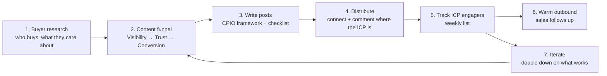
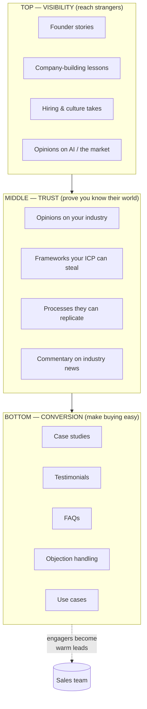
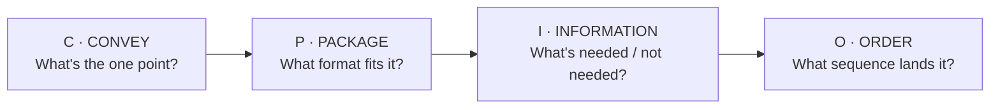
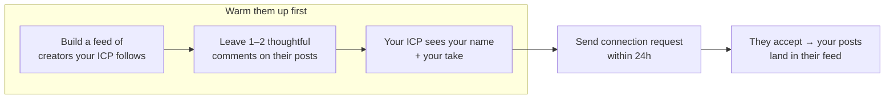
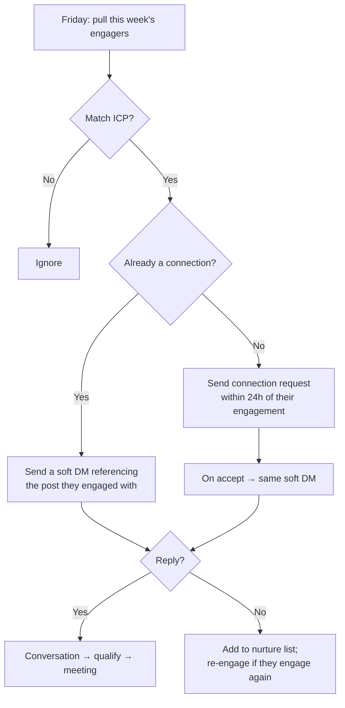
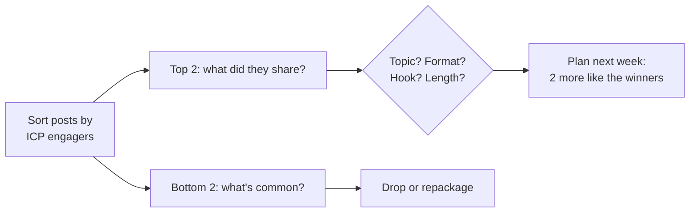

# LinkedIn Founder-Led Content System — Notes v2

> **What changed from v1:** duplicated sections merged into one flow, the "why" added behind every rule, metrics defined for tracking, the sales handoff spelled out, a worked example added for the post-writing framework, and every number checked against current (2026) data. Blanks marked `[ ___ ]` are for you to fill in — they're the parts only you can answer.

---

## 0. The whole system on one page



**The one-sentence version:** post content your buyers care about → get in front of them → notice which buyers engage → have sales talk to *those* people → repeat what worked.

Each step exists because the previous one is useless without it. Content with no distribution isn't seen. Distribution with no tracking means you can't tell who's warm. Tracking with no handoff means nobody follows up.

---

## 1. Buyer research — start here, work backwards

**Why first:** Every content decision downstream depends on this. If you skip it, you'll post what *you* find interesting, not what your buyer needs — which is the most common way founder-led content fails.

```text
   ┌──────────────┐                       ┌──────────────┐
   │   CONTENT    │  ◄── work backwards ──│    BUYER     │
   └──────────────┘                       └──────────────┘
   "What should I write?"          "What do they already care about?"
```

### Fill-in worksheet

| Question | Your answer |
|---|---|
| **What do I sell?** (one line, plain English) | `[ ___ ]` |
| **Who buys it?** (title, company size, industry) | `[ ___ ]` |
| **Who influences the decision?** (champion vs. signer) | `[ ___ ]` |

### What do they care about? (4 questions)

| # | Question | Where to find the answer | Your notes |
|---|---|---|---|
| 1 | What content do they already consume? | Look at what your best 10 customers like/comment on. Which creators, newsletters, podcasts? | `[ ___ ]` |
| 2 | What questions come up in their day-to-day? | Sales call recordings, support tickets, community threads (Slack/Reddit/Discord) | `[ ___ ]` |
| 3 | Current state → desired state in their role | "Today I ___, I wish I ___." Ask 5 customers directly. | `[ ___ ]` |
| 4 | What pain do they want to avoid? | Objections in lost deals, what got them fired/promoted before | `[ ___ ]` |

> **Output of this step:** a list of 10–20 topics your buyer already cares about. This is your content backlog. Everything below pulls from it.

---

## 2. The content funnel

**Why a funnel:** Different posts do different jobs. Visibility posts reach strangers but don't sell. Conversion posts sell but only to people who already trust you. If you only post one type, you either build an audience that never buys, or pitch to nobody.



### Suggested mix (5 posts/week)

| Stage | Share | Posts/week | Why this ratio |
|---|---|---|---|
| Visibility | ~40% | 2 | Feeds new people into the top. Broad topics = broad reach. |
| Trust | ~40% | 2 | This is where your ICP decides you're worth following. Usually the highest-converting content over time. |
| Conversion | ~20% | 1 | Enough to give warm people a reason to act; more than this reads as advertising and reach drops. |

> Adjust after 4 weeks based on what your *ICP* (not the general public) engages with — see §5.

### Concrete post ideas per stage

**Visibility** — *"Here's what it's like to build this."*
- The decision I'd reverse from last quarter and why
- What I got wrong hiring my first 5 people
- The unglamorous weekly ritual that keeps the team aligned
- A take on AI that goes against what everyone's saying

**Trust** — *"Here's how I think about your problem."*
- A 5-step framework for `[ ICP's recurring problem ]`
- "Most `[ ICP title ]`s do X. The good ones do Y."
- Reaction to a news item in your industry + what it means for them
- A checklist/cheat-sheet they'd screenshot and save

**Conversion** — *"Here's proof it works."*
- Customer story: before → what changed → after (with numbers)
- "People ask us `[ FAQ ]`. Here's the honest answer."
- "The #1 objection we hear is `[ X ]`. Here's why it's usually wrong / sometimes right."
- One specific use case, walked through screen by screen

---

## 3. Writing a post — the CPIO framework

> **Fix from v1:** The original notes spelled the acronym **CPTO** but mapped the letters as Convey / Packaging / **Information** / Order. "Information" starts with I, so it's **CPIO** — unless the speaker used a different third word (e.g. *Trim*). Check your original notes; the steps are the same either way.



### C — Convey: what is this post *for*?
Pick one:
- A story (something happened → what I learned)
- An opinion (I think X, most people think Y)
- A process (here's how we do it)
- A case study (here's what happened for a customer)
- A framework (here's how to think about it)

*Write the point in one sentence before writing anything else. If you can't, you don't have a post yet.*

### P — Package: what format fits?

| If the content is… | Package it as… | Why |
|---|---|---|
| A list of points / steps | **Carousel (PDF document post)** | Highest-reach format on LinkedIn in 2026 — swiping keeps people on the post 30–60s, and dwell time is the algorithm's #1 signal |
| Industry commentary | **Screenshot of the tweet/news + your reaction** | The screenshot is the hook; your take is the value |
| A dense process | **Infographic / cheat-sheet image** | Image posts hold attention longer than text; people save them |
| A story or a hot take | **Text post (900–1,300 characters)** | Text is best for conversation; this length is the sweet spot between "too short to hold" and "too long to finish" |
| Proof / personality | **Short native video** | Only if you're comfortable on camera; otherwise skip |

**Rules of thumb:** never put an external link in the post body (reach drops sharply — put it in the first comment). Don't reshare other people's posts — it's the worst-performing format.

### I — Information: what stays, what goes?
Ask of every line: *"If I delete this, does the reader still get the point?"* If yes, delete it.
- Keep: the specific detail that makes it real (a number, a name, a moment)
- Cut: background, caveats, throat-clearing, the second example when one is enough

### O — Order: what sequence lands it?
1. **Hook (first 1–2 lines)** — this is all people see before "…more". It must create a gap the reader wants closed.
2. **Context** — one or two lines, only what's needed to understand the point
3. **The meat** — the story / framework / opinion, one idea per line
4. **The takeaway** — one sentence, what to do with this
5. **A question or soft CTA** — gives people an easy reason to comment (comments extend reach far more than likes)

Then: **read it as a stranger.** Paste it into Claude and ask *"Read this cold. What's the point? Where did you lose interest?"*

### Hook patterns (original, adapt freely)
- Contrarian: *"Most `[ ICP ]` teams measure the wrong thing. Here's the one number that actually predicts `[ outcome ]`."*
- Confession: *"I spent `[ time/money ]` on `[ thing ]`. It was a mistake. Here's what I'd do instead."*
- Specific number: *"We cut `[ metric ]` by 43% in 6 weeks. No new tools. Here's the process."*
- Question-gap: *"Why does every `[ ICP ]` say they want `[ X ]`, but almost none of them ship it?"*

### Worked example (Trust-stage post)

| Step | Decision |
|---|---|
| **Convey** | Framework: "how to run a weekly pipeline review that takes 20 minutes instead of 60" |
| **Package** | Carousel — it's a 5-step process, and steps swipe well |
| **Information** | Keep: the 5 steps, the one question asked at each step, the before/after time. Cut: why we used to do it badly, the tool we use, three edge cases |
| **Order** | Slide 1: "Our pipeline review used to take an hour. Now it's 20 minutes. Five changes." → Slides 2–6: one step each → Slide 7: the one-line takeaway → Slide 8: "Which of these do you already do?" |

---

## 4. Pre-publishing checklist

Before hitting post, all three must be yes:

- [ ] Is this **non-obvious** to the reader? (If they could have guessed it, it's filler.)
- [ ] Is this something **only you** could write? (Your experience, your data, your customers.)
- [ ] Does it do at least one of:
  - [ ] Teach them something they didn't know
  - [ ] Increase their trust in you
  - [ ] Make them want to send it to a peer

Plus the mechanical checks:
- [ ] Hook works on its own (read only the first 2 lines — would you click "…more"?)
- [ ] No external link in the body
- [ ] One idea per line, no wall of text
- [ ] It's from the backlog in §1 (i.e., a buyer actually cares about this)

---

## 5. Distribution — getting in front of the ICP

**Why this matters more than the writing:** LinkedIn shows your post to a slice of your network first and only expands if that slice engages. If your network isn't full of ICP, even great posts reach the wrong people. Distribution is how you fix *who sees it*.



### The three moves

**1. Build an ICP feed.** Use Sales Navigator (or a saved search) to list your ICP. Then find the 20–30 creators *they* follow and comment on. Follow those creators. This is where your buyers are already paying attention.

**2. Comment before you connect.** Leave one or two substantive comments (a real point, not "great post") on those creators' posts. Two reasons:
- Your ICP reads the comments on posts they care about — you get seen without needing their follow.
- Requests sent after 1–2 comments get accepted ~41% of the time vs ~27% cold, and best within 24 hours of the comment. More than 4 comments doesn't help.

**3. Connect with ~100 ICP profiles per week — treat this as the ceiling, not a target.**
- LinkedIn's soft limit is ~100 requests per rolling 7 days for most accounts (up to ~150–200 with high acceptance rates / Sales Navigator; only ~50–80 for accounts under a few months old).
- Keep it to ~20–25/day so it looks human.
- **Withdraw requests older than 2–3 weeks.** A big pile of ignored invites lowers your future limit.
- **Skip the note unless it's specific.** Large datasets show a generic note doesn't raise acceptance and can lower it. A *specific* note (references their post, a shared context) doesn't change acceptance much either, but roughly doubles the chance they reply afterwards. So: blank request by default; specific note only for your top-tier targets.

### Weekly distribution targets

| Activity | Target | Time |
|---|---|---|
| Thoughtful comments on ICP-feed posts | 5–10 / day | 20 min/day |
| Connection requests (ICP only) | 60–100 / week | 15 min/day |
| Withdraw stale requests | Fridays | 5 min |
| Reply to every comment on your own posts | Same day | 10 min/day |

---

## 6. Tracking — define "worked" before you measure it

> **Fix from v1:** the original said "track what worked" but never defined *worked*. Vanity metrics (impressions, likes) tell you if the post spread. They don't tell you if it reached buyers. Track ICP engagement, not total engagement.

### The three numbers that matter

| Metric | What it tells you | How to get it |
|---|---|---|
| **ICP engagers / week** (people matching your ICP who liked, commented, or viewed your profile) | Is content reaching *buyers*? | Engagement-tracking tool (below) or manual: click through likers on each post, tag ICP matches in a sheet |
| **Warm conversations started / week** | Is tracking turning into pipeline? | Count DMs/replies from ICP engagers |
| **Meetings booked from LinkedIn / month** | Is the whole system working? | CRM source = LinkedIn |

Secondary (diagnostic, not goals): impressions, comments, profile views, follower growth, connection acceptance rate (should sit at 30–45%; below 20% means wrong targeting or a weak profile).

### Tools for pulling the ICP-engager list

The notes mentioned **Traxy** — it's real (that wasn't a typo). Options:

| Tool | What it does | Rough cost |
|---|---|---|
| **Traxy** | Tracks engagement on your posts + unlimited tracked profiles + competitor posts; routes qualified leads to Slack/HubSpot | ~$149/mo |
| **Trigify** | Broader "social signal" platform — LinkedIn + 10 other platforms, ICP scoring, Clay/HubSpot integrations | from ~$40/mo (credits) |
| **Embers, Signado, Linked Panda** | LinkedIn-only engager tracking ranked against your ICP | ~$29–49/mo |
| **Manual (free)** | Export likers/commenters per post, filter by title in a sheet | Your time (~1–2 hrs/week) |

*Start manual for 4 weeks so you understand the data, then buy a tool once the volume justifies it.*

### Weekly scorecard (copy this)

| Week | Posts | Impressions | ICP engagers | Warm convos | Meetings | Best post (topic / format) | Worst post |
|---|---|---|---|---|---|---|---|
| W1 | | | | | | | |
| W2 | | | | | | | |

---

## 7. Warm outbound — the handoff to sales

> **Fix from v1:** the original was a box that said "Content → Sales team → warm outbound". This is the step that turns everything above into revenue, so here's the actual process.



### Who does what

| Owner | Task | When |
|---|---|---|
| You (founder) | Post, comment, reply to comments | Daily |
| Sales / SDR (or you, early on) | Pull engager list, filter to ICP, connect + DM | Fridays + Monday follow-ups |
| Sales | Log conversations and meetings with source = LinkedIn | Ongoing |

### The soft DM — principles, not a template

The message should feel like a continuation of the post, not a pitch:
1. Reference the specific post they engaged with
2. Ask one easy question about *their* situation related to that topic
3. No link, no calendar, no "quick call?" in the first message

*Example shape:* "Saw you liked the piece on `[ topic ]` — curious, how are you handling `[ the problem ]` at `[ their company ]` right now?"

If they reply with a real answer, you have a conversation. The meeting ask comes 2–3 exchanges later, once you know there's a fit.

---

## 8. Iteration — the weekly review

Every Friday, 30 minutes, using the scorecard from §6:



### Track four things per post

| Variable | Examples | What to look for |
|---|---|---|
| **Topic** | hiring, pricing, industry news, process | Which *subjects* your ICP engages with |
| **Format & hook** | carousel vs text, contrarian vs story hook | Which *packaging* earns attention |
| **Length** | short text / 900–1,300 chars / long | Where your audience's dwell time peaks |
| **Media type** | text, image, carousel, video | Which types the algorithm expands for *you* |

**Rule:** push more of what works, less of what doesn't — but judge by *ICP* engagement, not total engagement. A post with 500 likes from peers and 2 from buyers is a visibility post that did its job; it's not evidence you should write more of them.

Give any change **4 weeks** before judging it. One post is noise.

---

## 9. Profile — set up once

Your profile is the landing page every post drives to. Fix it before you start posting.

| Element | Do this | Why |
|---|---|---|
| **Headshot** | Clear, face visible, no group photo | People connect with faces; it's the first trust signal |
| **Banner** | Value proposition + one piece of social proof (logo, number, award) | The only "billboard" you get on a profile view |
| **Headline** | Plain: *`Job title` at `Company` — `what you help ICP do`* | Shown on every post and comment; jargon here kills reach |
| **About** | First person, plain English, what you're building and for whom, 4–6 short lines | Most people read this after a post hooked them; keep it human |
| **Featured** | Case studies, press, product launches, your best post | Pin your proof where visitors see it |

---

## 10. Weekly operating rhythm

| Day | Post (stage) | Distribution | Other |
|---|---|---|---|
| **Mon** | Visibility (text) | Comments + connections | Send DMs to last week's ICP engagers |
| **Tue** | Trust (carousel) | Comments + connections | |
| **Wed** | Visibility (text or image) | Comments + connections | |
| **Thu** | Trust (text / screenshot-reaction) | Comments + connections | |
| **Fri** | Conversion (case study / FAQ) | Withdraw stale requests | Pull engager list, weekly review (§8), plan next week |

Post in the morning of your audience's timezone. Reply to comments within the first hour — early engagement decides how far the post travels.

---

## 11. Open questions to resolve

- [ ] **CPTO vs CPIO** — check the original handwritten page for the third letter.
- [ ] The crossed-out phrase after "General industry thought leadership" in the Trust section — worth recovering if legible.
- [ ] **Stage 1 blanks** — fill in §1 before anything else. Nothing works until this is done.
- [ ] Decide who owns the Friday engager pull (§7) — if it's nobody, it won't happen.

---

## Sources (2026 data referenced above)

- Connection limits (~100/week rolling, 150–200 for high-SSI/Sales Nav, lower for new accounts): PhantomBuster, Evaboot, LinkedRent, Opsily
- Note vs no-note acceptance (26.4% vs 26.4%; reply rate 9.4% vs 5.4% with a note): Belkins/Expandi data via Expandi and SalesRobot
- Warm-up effect (27% cold → 41% after 1–2 comments; best within 24h): Extrovert
- Format performance (document carousels highest reach/engagement; dwell time as primary signal; external links cut reach): AuthoredUp, Dataslayer, SocialInsider via Conbersa, GrowLeads
- Post length sweet spot (900–1,300 characters): ViralBrain
- Engagement-tracking tools and pricing (Traxy, Trigify, Embers, Signado, Linked Panda): Embers comparison, Trigify docs
